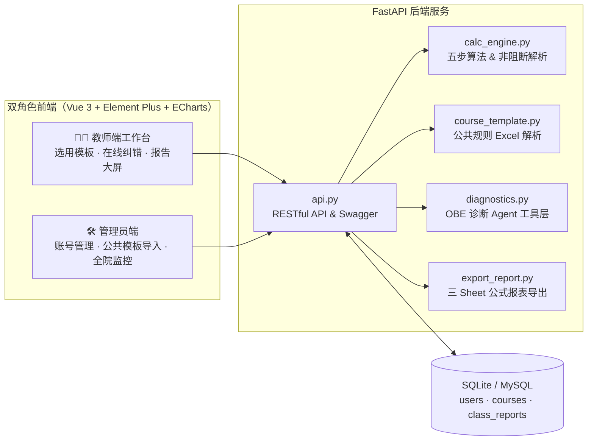

<div align="center">

# 🎓 课程目标达成度分析系统
### Course Outcome Attainment Analysis System (OBE)

**面向高校工程教育认证（OBE）的一站式课程目标达成度数字化分析与诊断平台**

配置一次 · 跨班复用 · 智能纠错 · 一键归档 · Agent 教学诊断

<p>
  
  
  
  
  
  
</p>

<p>
  <a href="#-核心特性">核心特性</a> •
  <a href="#-系统架构">系统架构</a> •
  <a href="#-核心算法与验证基准">核心算法</a> •
  <a href="#-快速开始">快速开始</a> •
  <a href="#-项目结构">项目结构</a> •
  <a href="#-开发路线图">路线图</a>
</p>

</div>

---

## 💡 项目背景

在高校工程教育专业认证（OBE）实践中，教师每学期均需完成课程目标达成度定量评价。传统方式依赖复杂嵌套的 Excel 手工公式，不仅耗时繁琐，而且极易因表头错位、超分漏填、权重口径不统一导致计算错误。

本系统将整个评价流程重构为清晰的数字闭环：

> **公共模板一键选用 / 规则配置** → **定制成绩模板下载（自动带入名单）** → **高容错 Excel 上传与在线标红纠错** → **五步引擎毫秒计算** → **多维可视化 + OBE 诊断建议** → **三 Sheet 带公式标准 Excel 一键归档**

<!-- 📸 等 Vue 3 前端完成后，在此放置工作台与达成度可视化大屏截图 -->
<!--
<div align="center">
  
</div>
-->

---

## ✨ 核心特性

| 模块 | 亮点说明 |
| :--- | :--- |
| **🏫 双角色协同 & 公共模板库** | **管理员**可管理教师账号、监控全院达成度，并通过标准《课程规则配置模板.xlsx》一键导入发布全院**公共课程模板**；**教师**开箱即用，一键选用统考课程模板或自建私有规则跨班复用。 |
| **📐 结构与成绩分离** | 网页端可视化配置成绩评定方法（平时环节可自由增删）、大纲对应矩阵（实时列归一化预览产出权重与理论满分）及试卷大题/小题结构；系统动态生成专属录入模板，**教师只填分数，不写任何公式**。 |
| **🛡️ 高容错解析 & 在线纠错** | 支持动态锚点扫描（跳过合并标题行）、列名别名模糊匹配、末尾统计行过滤与 `\xa0` 清洗；支持**非阻断解析**，精确定位超分/空值/缺考单元格，网页直接改分重算，免去本地反复改表重传。 |
| **📊 三表合一标准归档导出** | 一键导出《达成度计算表.xlsx》，内置 **3 个工作表**：① 对齐学校标准的《达成度计算表》（底部保留 `=AVERAGE` / 求和 / 达成度公式便于复核）；②《课程目标评价汇总表》；③《全班学生得分明细表》。 |
| **🤖 OBE 教学诊断 Agent** | 内置 4 维真实数据下钻工具（环节得分率定位、期末低分难题 Top N、全班学情分布与反差生画像、历史班级对比），自动生成有数据支撑的持续改进报告，并预留大模型 Tool-Calling 与 RAG 扩展接口。 |

---

## 🏗️ 系统架构

采用 **“轻重解耦”** 架构：海量原始成绩解析与矩阵计算在后端内存毫秒级完成；轻量化的用户账号、可复用课程规则模板与班级历史报告快照持久化至关系型数据库（默认内置 SQLite 开箱即用，平滑兼容 MySQL）。



---

## 🧮 核心算法与验证基准

系统严格遵循 OBE 定量评价五步算法，核心公式如下：

1. **列归一化产出权重**：

$$\text{产出权重}_{i,j} = \text{考核环节权重}_j \times \frac{\text{大纲矩阵相对比例}_{i,j}}{\sum_k \text{大纲矩阵相对比例}_{k,j}}$$

2. **期末等比例得分率折算**（自动兼容“某目标不考期末”边界场景）：

$$\text{期末贡献}_i = \frac{\text{目标 } i \text{ 卷面实得均分}}{\text{目标 } i \text{ 卷面满分}} \times \left(\text{产出权重}_{i,\text{期末}} \times 100\right)$$

3. **课程目标最终达成度**：

$$\text{课程目标达成度}_i = \frac{\text{平时各环节折算贡献之和}_i + \text{期末贡献}_i}{\text{理论满分}_i}$$

### 44 人真实班级回归验证基准（`高等数学A（II）· 23智能制造1班`）

| 课程目标 | 平时贡献 | 期末贡献 | 实际得分 | 理论满分 | 达成度 | 达标判定（阈值 65%） |
| :--- | :---: | :---: | :---: | :---: | :---: | :---: |
| **课程目标 1** | 12.15 | 28.36 | **40.51** | 64.40 | **62.9%** | ❌ 未达标（期末得分率 56.7%） |
| **课程目标 2** | 21.45 | 5.95 | **27.40** | 35.60 | **77.0%** | ✅ 达标 |

> 单学生（俞高敏，目标1 `71.5%` / 目标2 `82.6%`）手工推演结果与计算引擎、导出 Excel 公式结果逐位一致。

---

## 🚀 快速开始

### 1. 环境要求
- Python `3.10+`（项目虚拟环境使用 `3.12`）
- Node.js `18+`（用于 Vue 3 前端工程）

### 2. 启动后端服务

```powershell
# 进入后端目录并激活虚拟环境
cd backend
.\venv\Scripts\Activate.ps1

# 启动 FastAPI 服务
python -m uvicorn api:app --reload --port 8000
```

启动成功后访问：
- **交互式 API 文档（Swagger UI）**：`http://127.0.0.1:8000/docs`
- **当前 Web 界面**：`http://127.0.0.1:8000`

### 3. 一键运行后端全流程验收测试

无需手动配置数据，1 秒完成 8 项核心能力（双角色登录、公共模板导入闭环、44 人解析与超分定位、边界防除零、三 Sheet 导出、OBE 诊断草稿、全院监控）自动化回归测试：

```powershell
.\backend\venv\Scripts\python.exe .\backend\test_api.py
```

### 4. 默认测试账号

| 角色 | 账号 | 密码 | 权限说明 |
| :--- | :---: | :---: | :--- |
| **教师** | `teacher` | `123456` | 选用公共模板、配置私有课程、成绩纠错与达成度分析、历史报告管理 |
| **管理员** | `admin` | `admin123` | 教师账号管理、公共课程规则模板库（含 Excel 导入）、全院达成度监控 |

---

## 📂 项目结构

```text
course-outcome-attainment-analysis/
├── backend/
│   ├── api.py                # FastAPI 核心路由（30 个接口：认证/配置/模板/解析/导出/诊断/管理）
│   ├── calc_engine.py        # 五步达成度计算引擎、边界保护与非阻断预览解析
│   ├── db.py                 # 数据库持久化层（users / courses / class_reports 三表）
│   ├── course_template.py    # 公共课程规则模板 Excel（3 Sheet）生成与导入解析
│   ├── diagnostics.py        # OBE 诊断 Agent 4 维下钻统计工具与改进建议生成
│   ├── export_report.py      # 三 Sheet 归档报表导出（含 Excel 自动计算公式）
│   └── test_api.py           # 后端 8 项全流程一键自动化验收脚本
├── frontend/                 # Web 前端页面（即将升级为 Vue 3 + Element Plus + ECharts）
├── docs/                     # 完整需求与设计文档
│   ├── 需求分析.md
│   ├── 达成度计算流程.md
│   ├── 项目文档.md
│   └── 开发流程.md
└── 示例/                     # 44 人真实测试数据集（平时成绩表、期末小题模板等）
```

---

## 🗺️ 开发路线图

- [x] **核心计算内核**：五步算法、列归一化、不考期末边界保护、44 人真实数据验证
- [x] **高容错导入与预览**：锚点扫描、别名匹配、统计行过滤、单元格级异常定位
- [x] **三表合一报表导出**：《达成度计算表》（含公式）+《评价汇总表》+《学生得分明细表》
- [x] **持久化与双角色后端**：SQLite/MySQL 兼容三表、管理员账号管理、公共模板 Excel 导入
- [x] **OBE 诊断下钻工具层**：环节得分率、低分难题 Top N、学情分布、历史对比与自动草稿
- [ ] **Vue 3 前端工作台重构**：高颜值学术工作台、成绩在线增删改查标红表格、ECharts 可视化大屏
- [ ] **管理员端前端页面**：教师账号管理、公共课程模板库发布与全院达成度监控视图
- [ ] **工程化部署与 AI 进阶**：Docker Compose 一键编排、接入大模型 Tool-Calling Agent（预留 RAG）

---

## 📚 相关文档

- 📖 [需求分析说明书](docs/需求分析.md) — 角色权限、功能模块与录入分工
- 🧮 [达成度计算流程指南](docs/达成度计算流程.md) — 五步算法详解与 44 人 / 单学生验算过程
- 🏛️ [项目技术文档](docs/项目文档.md) — 技术栈、数据库设计与接口说明
- 📋 [开发流程与进度日志](docs/开发流程.md) — 阶段规划与迭代记录

<a href="https://star-history.com/#1579231583/course-outcome-attainment-analysis&Date">
  
</a>
