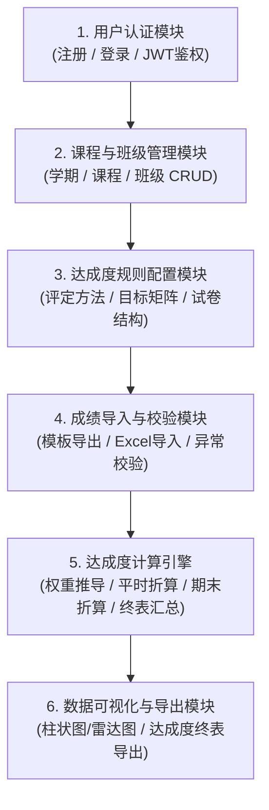

# 课程目标达成度分析系统 — 需求分析说明书

> 📌 本文档详细记录系统的业务需求、功能模块划分以及数据录入方式。

---

## 一、用户角色与权限

1. **教师（主要用户）**：
   - 账号注册、登录与个人信息维护。
   - 课程与教学班管理：创建课程、管理开课学期和教学班。
   - 达成度规则配置：设置成绩评定方法、课程目标与环节对应矩阵、试卷题目结构。
   - 成绩数据导入：下载定制成绩模板、批量导入平时成绩与期末小题得分、在线查看与修改。
   - 分析结果查看与导出：查看各目标达成度明细、班级评价终表、导出 Excel/PDF 报告。

2. **管理员（可选/后续扩展）**：
   - 系统用户管理与权限分配。
   - 全院/全校各课程达成度汇总监控。

---

## 二、数据录入方式分工原则

为了兼顾**操作便捷度**与**高校教师的使用习惯**，系统对数据录入采取如下划分：

### 1. 网页端表单交互录入（参数轻量、易实时校验）
- **课程及班级基本信息**：课程名称、课程代码、开课学期、班级名称、学生人数等。
- **课程目标定义**：支持添加任意多个课程目标（目标1、目标2……及对应说明文本）。
- **成绩评定方法**：
  - 平时占比（如40%）、期末占比（如60%）。
  - 平时细项环节自定义：支持新增环节（如作业、课堂表现、测验、实验等）并设置其在平时成绩中的占比。
  - *系统实时自动校验细项之和是否为 100%*。
- **目标与考核环节对应关系矩阵**：
  - 网页提供网格交互表单，直接填入教学大纲中的权重系数。
  - *系统右侧/下方实时联动计算并展示产出权重矩阵及各目标理论满分（如64分、36分）*。
- **期末试卷题目结构配置**：
  - 设置小题数量、各小题满分分值。
  - 设置每道小题归属的课程目标（单选映射）。
  - *系统实时统计试卷总满分（校验是否为100分）及各课程目标在期末中的理论满分*。

### 2. Excel 批量模板导入（数据量大、行数多）
- **定制成绩模板一键下载**：
  - 系统根据教师前置在网页配置的环节与试卷结构，**动态生成专属的《成绩录入模板.xlsx》**。
  - 模板表头自动对齐（平时各环节列、期末各小题列），彻底杜绝表头错位。
- **高容错 Excel 解析与【列映射确认抽屉】**：
  - **动态锚点扫描**：自动向下扫描寻找包含“学号”或“姓名”的数据起始行，忽略顶部的标题行、空行或合并单元格。
  - **列名智能模糊匹配与别名容错**：自动去除空格与特殊字符，智能匹配“平时作业/作业”、“学号/ID”等。
  - **列映射确认抽屉（强保险）**：上传后弹窗展示系统字段与 Excel 列的映射关系，提供下拉选择修正未识别列，并实时预览前 3~5 行数据，经教师确认后再真正入库。
- **智能数据校验与【在线就地纠错】**：
  - **前置数据合规检查**：
    - 检查学生学号、姓名是否缺失或重复。
    - 检查分数格式（是否为合法数值，遇到“缺考/请假”等非数字标记或空值支持自动置0或标记提示）。
    - 检查小题实得分是否超过设定满分（超分自动高亮标红并拦截）。
  - **网页端在线编辑纠错（免反复重传）**：导入后若出现个别学生分数有误或超分标红，教师可直接在网页表格单元格上双击修改纠错，系统实时触发重新计算，无需重新修改 Excel 再传一遍。

---

## 三、核心功能模块规划

### 模块详细清单：

1. **用户认证模块**：
   - 手机号/工号/邮箱注册与登录。
   - 密码加密存储、基于 JWT Token 的接口权限鉴权。

2. **课程与班级管理模块**：
   - 课程元数据维护（课程名称、课程代码、学期等）。
   - **单班级独立核算**：每次分析以具体的一个教学班为独立单元，直接输入班级名称（如“23智能制造1班”）即可开展分析，不引入复杂的跨班合并与排课逻辑。

3. **达成度规则配置模块**：
   - 支持多课程目标（目标1~N）动态扩展。
   - 成绩评定方法可视化配置器。
   - 课程目标与考核环节权重映射网格编辑器。
   - 期末试卷小题结构编辑器。

4. **成绩导入与管理模块**：
   - 根据规则动态渲染并生成 Excel 模板。
   - Excel 文件解析（支持 `.xlsx`、`.xls`）。
   - 导入预览、字段映射确认、异常标红提示。

5. **达成度自动计算引擎**：
   - 后端 Python/Pandas 高精度计算引擎。
   - 产出权重推算、平时折算分推算、期末等比例折算分推算。
   - 个人达成度明细矩阵计算、全班平均值与达成度汇总。

6. **报表与可视化导出模块**：
   - **核心指标卡片**：顶部大字呈现各课程目标达成度百分比，直观标识“达标（绿色）/未达标（黄色预警）”。
   - **终表所见即所得预览**：网页端完整呈现《课程目标评价达成情况》表格（理论满分、实际得分均值、达成度百分比），无需每次下载 Excel 即可核对。
   - **可视化图表**：生成清晰的达成度柱状对比图（带合格基准红虚线，支持一键复制用于教学汇报 PPT）。
   - **双重 Excel 一键导出**：
     - 导出《课程目标达成度评价汇总表.xlsx》（标准归档格式，供教务与工程认证核查）。
     - 导出《全班学生得分明细大表.xlsx》（含全体学生各环节、各小题计算明细，供教学备查）。

---

## 四、更新日志

| 日期 | 内容 |
| :---: | :--- |
| 2026-11-17 | 完成录入方式划分（网页交互 vs Excel批量导入）、确定六大功能模块及业务细节 |
