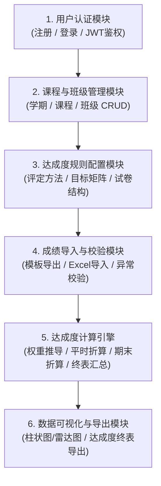

# 课程目标达成度分析系统 — 需求分析说明书

> 📌 本文档详细记录系统的业务需求、功能模块划分以及数据录入方式。
>
> **实现状态图例**：✅ 已实现　🟡 部分实现　⏳ 未实现（规划中）

---

## 零、当前实现进度速览

| 需求项 | 状态 | 说明 |
| :--- | :---: | :--- |
| 成绩评定方法配置（平时/期末占比、平时环节增删） | ✅ | 网页可配置，实时校验占比之和 |
| 课程目标与考核环节对应关系矩阵 | ✅ | 网页可编辑，列归一化自动计算 |
| 产出权重实时预览 | ✅ | 矩阵下方实时显示产出权重表 + 理论满分 + 各列比例之和 |
| 期末试卷结构配置（大题→小题） | ✅ | 网页可配置，校验总分 100 |
| 动态生成平时/期末成绩录入模板 | ✅ | 中文文件名，按配置生成列 |
| 高容错 Excel 解析 | ✅ | 锚点扫描 / 别名 / 统计行过滤 / 学号清洗 |
| 前置数据校验 | ✅ | 区间、超分、重复、缺失 |
| 五步达成度计算 | ✅ | 44 人真实数据验证通过 |
| 达成度结果表格展示 | ✅ | 含达标徽章 |
| 产出权重明细展示 | ✅ | 矩阵下方实时预览，教师可核对 5.33/10.67 等归一化结果 |
| 列映射确认抽屉 | 🟡 | 后端 `/api/parse` 已返回完整表头、列映射与前5行样本，待前端抽屉对接 |
| 在线就地纠错 | 🟡 | 后端已支持非阻断式单元格级错误定位与 JSON 重算/导出，待前端表格对接 |
| 指标卡片 / 柱状图 / 评价终表 | ⏳ | 待前端工作台展示 |
| Excel 报表导出 | ✅ | 一键导出含 3 个 Sheet 的工作簿：《达成度计算表》《课程目标评价汇总表》《全班学生得分明细表》 |
| 用户认证 / 数据库 / 课程管理 | 🟡 | 后端 `db.py` + `api.py` 已完整实现双角色与三表持久化，待前端页面对接 |
| 期末模板自动带入学生名单 | ✅ | 后端已支持从平时成绩表提取并缓存学生名单，下载期末模板时自动预填学号姓名 |
| 公共课程模板库（含 Excel 导入配置） | 🟡 | 后端 `course_template.py` + `/api/templates/*` 已完成并通过测试，待前端界面对接 |
| 轻量管理员端（账号管理 + 全院监控） | 🟡 | 后端 `/api/admin/*`（账号增/停/重置 + 全院汇总监控）已完成，待前端界面对接 |
| OBE 诊断 Agent（预留 RAG 扩展） | 🟡 | 后端 `diagnostics.py` 4 维数据下钻工具 + `/api/diagnostics/analyze` 已完成；RAG 远期保留 |

---

## 一、用户角色与权限

1. **教师（主要用户）**：
   - 账号注册、登录与个人信息维护。
   - **开箱即用工作台 & 课程模板复用**：可直接从管理员发布的**「公共课程模板库」**一键选用统考大课规则（如《高等数学A(II)》），也可自主新建或复制微调私有课程规则；同一门课程规则可跨多个教学班复用。
   - **成绩数据导入与可视化增删查改**：下载定制成绩模板（支持自动预填全班学生名单）、上传平时与期末成绩、在网页类 Excel 表格中搜索/筛选异常、增删学生、双击改分纠错、一键处理缺考/缓考学生。
   - **分析结果查看、归档与导出**：查看指标卡片、评价终表、柱状对比图；填写或通过 AI Agent 生成“达成情况诊断与持续改进措施”；一键导出三 Sheet《达成度计算表.xlsx》；随时查看历史报告并重新导出 Excel。

2. **管理员（教研室 / 院系管理员）**：
   - **公共课程模板库管理**：通过网页表单或上传标准《课程规则配置模板.xlsx》一键导入并发布公共课程规则模板（含成绩评定方法、目标矩阵、试卷小题结构），供全院教师直接取用。
   - **教师账号管理**：查看教师列表、新增教师账号、启用/禁用账号、重置登录密码。
   - **全院达成度汇总监控**：只读汇总查看全院各课程、各班级的达成度上报情况与未达标预警。

---

## 二、数据录入方式分工原则

为了兼顾**操作便捷度**与**高校教师的使用习惯**，系统对数据录入采取如下划分：

### 1. 网页端表单交互录入（参数轻量、易实时校验）
- **课程及班级基本信息**：课程名称、课程代码、开课学期、班级名称、学生人数等。
- **课程目标定义**：支持添加任意多个课程目标（目标1、目标2……及对应说明文本）。
- **成绩评定方法**：
  - 平时占比（如40%）、期末占比（如60%）。
  - 平时细项环节自定义：支持新增环节（如作业、课堂表现、测验、实验等）并设置其在平时成绩中的占比。
  - 平时环节不是固定三项；教师可删除不适用的环节，例如课程不安排测验时应允许只保留作业和课堂表现。
  - 所有启用的平时环节占平时成绩的比例之和必须为100%；环节删除后，占比可重新分配。
  - *系统实时自动校验细项之和是否为 100%*。
- **目标与考核环节对应关系矩阵**：
  - 网页提供网格交互表单，直接填入教学大纲中的权重系数。
  - **重要：矩阵填的是“相对比例”，不是“占比”**。同一列各目标的值之和不必为 1（示例中列和为 0.6 / 0.5 / 0.3 / 0.6），系统按列归一化换算成实际分配比例。
  - 归一化公式：`产出权重[目标][环节] = 环节权重 × 矩阵值 ÷ 该列之和`。
  - *系统应实时联动计算并展示产出权重矩阵及各目标理论满分（示例：64.40 分、35.60 分）*。✅ 已实现：矩阵下方实时预览产出权重表、理论满分，并显示各列比例之和，全 0 列会标红提示。
- **期末试卷题目结构配置**：
  - 支持按“大题 → 小题”分组配置，设置大题名称、小题数量、各小题满分和课程目标，支持**批量快速添加 N 道同分值小题**，增删小题时题号自动从 `1..N` 连续顺延。
  - 每道小题只归属一个课程目标；支持某课程目标“不考期末”（矩阵期末比例为 0 时允许试卷无该目标题目）。
  - *系统实时统计试卷总满分及各课程目标在试卷中的卷面满分*。
  - 管理员侧支持下载并上传标准《课程规则配置模板.xlsx》，将评定方法、目标矩阵与试卷结构一次性批量导入为公共课程模板。

### 2. Excel 批量模板导入（数据量大、行数多）
- **试卷结构模板导入**（⏳ 未实现）：
  - 教师可以先填写《试卷结构配置模板.xlsx》并上传，系统校验小题编号、分值、课程目标和试卷总分。
  - 系统根据确认后的试卷结构自动生成《期末小题成绩录入模板.xlsx》。
- **学生成绩模板结构**（✅ 已实现）：
  - 采用“学号、姓名、每道小题一列”的简单结构，不包含教师手工维护的总分、目标分数或公式。
  - 期末模板表头形如 `第1题(3分/课程目标1)`，系统按“第N题”前缀定位列。
- **定制成绩模板一键下载**（✅ 已实现）：
  - 系统根据教师前置配置的平时环节和试卷结构，**动态生成专属模板**。
  - 平时模板列 = `学号 | 姓名 | 已启用平时环节…`；期末模板列 = `学号 | 姓名 | 第N题(满分/目标)…`。
  - 下载文件名为中文：《平时成绩录入模板.xlsx》《期末小题成绩录入模板.xlsx》。
- **真实 Excel 成绩上传**（✅ 已实现）：
  - 支持 `.xlsx` 原文件上传（`.xls` 尚未支持，openpyxl 不支持旧格式）。
  - 平时成绩表允许存在合并标题行、统计行和额外列，系统动态定位学号、姓名及已配置平时环节列。
  - 期末成绩表按“第N题”表头定位小题成绩列。
- **高容错 Excel 解析**（✅ 已实现）：
  - **动态锚点扫描**：自动向下扫描寻找包含“学号”和“姓名”的表头行，忽略顶部标题行、空行。
  - **列名智能模糊匹配与别名容错**：自动去除空格、`\xa0` 与括号内容，支持 `平时作业/作业成绩/课后作业`、`课堂参与/考勤/表现`、`小测验/随堂测试` 等别名。
  - **统计行过滤**：`平均/合计/统计/最高/最低/及格率/标准差/汇总` 行自动剔除。
- **列映射确认抽屉**（⏳ 未实现）：
  - 后端 `build_column_mapping()` 已能返回“字段 → 列索引”映射及缺失字段列表。
  - 前端尚未实现弹窗预览、下拉修正与前 3~5 行数据预览。
- **智能数据校验**（✅ 已实现）：
  - 学号、姓名缺失或重复检查。
  - 分数格式检查（非数值/空值直接报错并指出学号与环节）。
  - 平时成绩 0~100 区间检查。
  - 期末小题得分非负且不超过该题满分（超分拦截并提示具体学号与题号）。
  - 期末成绩缺失检查（列出缺失学号）。
- **网页端在线可视化增删查改与纠错**（🟡 后端已就绪，前端待接）：
  - 上传后以类 Excel 表格直观展示全班成绩，支持按学号/姓名搜索、一键筛选“仅看异常行”。
  - 超分/负数/空值单元格红底高亮并提示原因，点击即可就地修改；支持手动新增学生、删除缓考/休学学生、一键对缺考学生期末补 0 分，修改后实时重算并直接导出最新 Excel。

---

## 三、核心功能模块规划

### 模块详细清单：

1. **用户认证模块**：
   - 手机号/工号/邮箱注册与登录。
   - 密码加密存储、基于 JWT Token 的接口权限鉴权。

2. **课程与班级管理模块**：
   - 课程元数据维护（课程名称、课程代码、学期等）。
   - **单班级独立核算**：每次分析以具体的一个教学班为独立单元，直接输入班级名称（如“23智能制造1班”）即可开展分析，不引入复杂的跨班合并与排课逻辑。

3. **达成度规则配置模块**：
   - 支持多课程目标（目标1~N）动态扩展。
   - 成绩评定方法可视化配置器。
   - 课程目标与考核环节权重映射网格编辑器。
   - 期末试卷大题/小题结构编辑器，支持批量设置和单题调整。
   - 试卷结构模板导入与期末小题成绩模板生成。

4. **成绩导入与管理模块**：
   - 根据规则动态渲染并生成 Excel 模板。
   - Excel 文件解析（支持 `.xlsx`、`.xls`）。
   - 导入预览、字段映射确认、异常标红提示。

5. **达成度自动计算引擎**：
   - 后端 Python/Pandas 高精度计算引擎。
   - 产出权重推算、平时折算分推算、期末等比例折算分推算。
   - 个人达成度明细矩阵计算、全班平均值与达成度汇总。

6. **报表与可视化导出模块**：
   - **核心指标卡片**（⏳）：顶部大字呈现各课程目标达成度百分比，直观标识“达标（绿色）/未达标（黄色预警）”。
   - **终表所见即所得预览**（⏳）：网页端完整呈现《课程目标评价达成情况》表格（理论满分、实际得分均值、达成度百分比）。
   - **可视化图表**（⏳）：达成度柱状对比图（带合格基准红虚线，支持一键复制用于教学汇报 PPT）。
   - **双重 Excel 一键导出**（🟡 部分实现）：
     - ✅ 已实现《达成度计算表.xlsx》：按学校现有表格格式复刻（标题 / 课程信息 / 目标表头 / 各环节理论满分 / 学生逐人明细 / 各子项均分 / 各目标实际得分 / 达成度），汇总行使用 Excel 公式，教师可自行核对重算。
     - ⏳ 待实现《全班学生得分明细大表.xlsx》（含各小题计算明细）。
   - ✅ 当前已实现的最小版本：达成度汇总表格（平时贡献 / 期末贡献 / 实得 / 理论满分 / 达成度徽章）+ 环节权重表 + 产出权重实时预览。

---

## 四、更新日志

| 日期 | 内容 |
| :---: | :--- |
| 2026-11-17 | 完成录入方式划分（网页交互 vs Excel批量导入）、确定六大功能模块及业务细节 |
| 2026-11-18 | 确定“结构配置与成绩录入分离”方案：试卷结构在系统配置，系统生成录入模板，教师只填分 |
| 2026-11-18 | 明确矩阵为“相对比例”而非“占比”，系统按列归一化换算 |
| 2026-11-18 | 补充实现进度速览表，逐项标注 ✅ / 🟡 / ⏳ 状态 |
| 2026-11-19 | 明确完整工程化交付方案：新增课程级合格阈值、期末模板自动带入学生名单、不考期末目标边界保护、在线纠错 JSON 数据流与三 Sheet 标准 Excel 报表导出 |
| 2026-11-19 | 需求最终定稿：明确双角色分工（新增轻量管理员端管理教师账号、全院监控及公共课程模板库 Excel 一键导入）、前端成绩可视化增删查改表格、历史报告重下与重载、以及 AI 诊断 Agent 规划（RAG 作为远期预留） |
