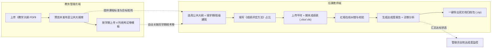
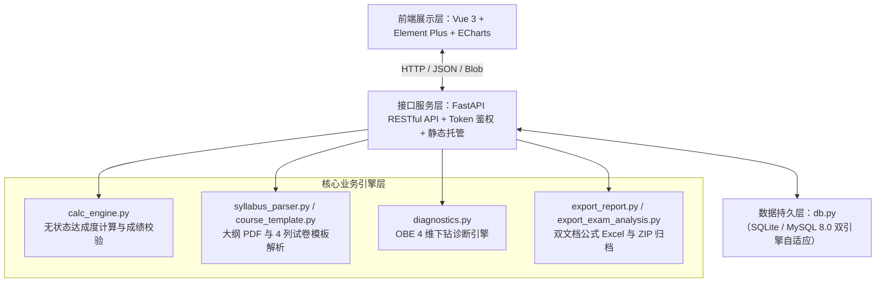
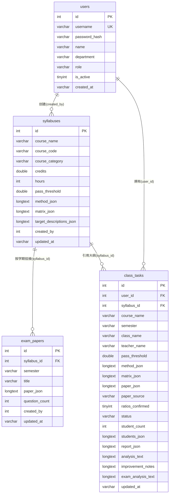

# 《课程目标达成度分析系统》项目实训报告

> **项目名称**：高校 OBE 课程目标达成度分析与教学质量评价系统（v4.0）  
> **实训方向**：全栈 Web 工程开发（FastAPI + Vue 3 + MySQL/SQLite + Docker）  
> **姓名**：郑宇豪  
> **学号**：231070102124  
> **班级**：23信息1班  
> **完成日期**：2026 年 11 月  

---

## 一、项目背景与实训目标

### 1.1 项目背景
在工程教育专业认证与高校本科教学质量保障体系中，**OBE（Outcome-Based Education，成果导向教育）** 要求每门课程在每学期末必须定量评价“课程目标达成度”，并同步形成**《课程目标达成度数据分析表》**与**《考试试卷分析表》**两份正式教学归档材料。

在调研高校真实教学归档流程后，发现一线教师与教务管理端长期面临以下痛点：
1. **手工计算繁琐且极易出错**：教师需依据教学大纲的“课程目标 × 考核环节”对应矩阵进行列归一化换算，再将平时成绩（作业、考勤、测验等）与期末试卷各小题得分逐人折算，全班数十至上百人的 Excel 公式维护成本极高。
2. **标准与执行脱节**：教学大纲属于长期稳定的课程标准，统考大课的期末试卷按学期变化，而不同教师所带教学班的平时成绩构成比例各异。传统做法靠手工复制 Excel 模板，极易出现版本混乱、误改大纲权重或公式引用错位。
3. **归档材料重复劳动**：教师期末除了提交《达成度数据分析表》，还需单独统计卷面 5 档分数段分布、最高/最低/平均分、各大题得分率并填写《考试试卷分析表》，数据同源却要重复制作两份报表。
4. **缺少面向教学改进的数据下钻**：传统统计止步于“达成度百分比”，难以快速定位具体是哪个考核环节、哪几道期末试题拉低了达成度，也难以识别“平时分高但期末卷面低”的学情反差群体。

### 1.2 实训目标
本项目旨在设计并工程化落地一套面向学院级部署的 **OBE 课程目标达成度分析系统**，实现以下目标：
- **理顺高校真实三层业务模型**：彻底分离「公共教学大纲（无学期）」「统考期末试卷（按学期）」「教师班级分析任务（按班级）」，消除数据冗余与概念混淆。
- **实现高精度、无状态并发安全的达成度计算引擎**：算法与学校真实归档表逐位对齐，支持动态考核环节、动态课程目标及“某目标不考期末”等边界场景。
- **打通端到端高效工作流**：支持高校《教学大纲 PDF》智能解析、4 列《期末试卷结构模板》预览微调、`.xlsx`/`.xls` 成绩表自动列映射与红框在线纠错。
- **一次上传，双表归档**：自动生成可视化图表、OBE 4 维诊断分析，并一键导出包含 **4-Sheet《达成度数据分析表.xlsx》** 与 **2-Sheet《考试试卷分析表.xlsx》** 的双文档归档包（ZIP）。
- **具备生产级部署能力**：支持 SQLite / MySQL 8.0 双引擎无缝切换，提供 Docker Compose 一键部署与内网离线部署方案。

---

## 二、需求分析

### 2.1 用户角色与职责边界

系统采用**双角色权限隔离**设计，职责边界清晰、零重叠：

| 角色 | 核心职责 | 主要功能权限 |
|---|---|---|
| **教务管理员 (`admin`)** | 建标准、管统考卷、管账号、看全院监控 | 1. 上传《课程教学大纲 PDF》智能提取并发布公共大纲<br>2. 按学期为统考大课挂接/微调 4 列《期末试卷结构》<br>3. 教师账号创建、启停与密码重置<br>4. 全院已完成班级的达标率汇总监控 |
| **任课教师 (`teacher`)** | 选大纲建班、定占比、传成绩、出双表归档 | 1. 从公共大纲库选课并填写学期/班级建班（自动关联同学期统考卷）<br>2. 按学校《成绩评定方法表》层级版式填写本班平时/期末占比<br>3. 上传平时与期末成绩表，在线修正红框异常<br>4. 查看诊断大屏、编辑三段分析文本、一键导出双表归档包 |

### 2.2 核心业务流程图



### 2.3 非功能性需求
1. **并发安全与数据隔离**：计算引擎采用纯函数无状态设计，杜绝多教师同时操作导致的状态串扰；所有受保护接口强制 Bearer Token 鉴权，严格按 `user_id` 隔离教师私有班级任务。
2. **历史归档可追溯**：每个班级任务独立冻结保存当时的规则快照、学生清洗成绩快照与三段分析文本，确保后续大纲改版不影响已归档历史报告。
3. **容错与易用性**：成绩上传采用非阻断解析机制，支持表头自动定位、别名列匹配、末尾统计行过滤与逐格红框即时修改。
4. **跨平台部署能力**：后端零 C/Rust 扩展硬依赖，兼容 Windows 本地开发与 Linux Docker 容器化生产部署。

---

## 三、系统总体架构与技术选型

### 3.1 系统总体架构



### 3.2 技术选型说明

| 层级 | 技术选型 | 选型理由 |
|---|---|---|
| **前端框架** | Vue 3 + Vite 5 + Element Plus | 组件化开发效率高，构建产物体积可控，Element Plus 适合高校后台管理与表单表格场景 |
| **数据可视化** | Apache ECharts 5 | 原生支持合格基准虚线（`markLine`）、分组柱状图与 2x 高清 PNG 一键导出（便于教师插入 PPT） |
| **后端框架** | FastAPI + Uvicorn | 性能高、路由声明清晰、文件上传与流式下载（`StreamingResponse`）支持完善，可直接托管前端静态文件 |
| **文档与表格处理** | `pypdf` + `openpyxl` + `xlrd` | 均为纯 Python 实现，零系统级 DLL 冲突；完整覆盖 PDF 文本解析、`.xlsx`/`.xls` 读取及带 Excel 动态公式的高保真导出 |
| **数据库** | SQLite 3 / MySQL 8.0 (`PyMySQL`) | 本地开发零配置直跑 SQLite；生产环境配置 `DATABASE_URL` 即可无缝切换 MySQL 8.0，支持多教师并发 |
| **容器部署** | Docker 多阶段构建 + Docker Compose | 统一编译前端并封装运行环境，配合 MySQL 健康检查与数据卷持久化，实现跨服务器一键上线 |

### 3.3 项目核心目录结构

```text
课程目标达成度分析系统/
├── Dockerfile                      # 多阶段构建镜像（Node 20 构建前端 + Python 3.12 运行时）
├── docker-compose.yml              # App + MySQL 8.0 一键编排与持久化卷配置
├── .env.example                    # 生产环境变量模板
├── backend/
│   ├── api.py                      # FastAPI 主服务（29 个核心接口 + 静态托管）
│   ├── db.py                       # SQLite / MySQL 8.0 双引擎持久层（4 张核心表）
│   ├── calc_engine.py              # 无状态核心达成度计算引擎与非阻断解析器
│   ├── syllabus_parser.py          # 高校《教学大纲 PDF》智能提取模块
│   ├── course_template.py          # 4 列《期末试卷结构模板》生成与解析模块
│   ├── diagnostics.py              # OBE 4 维下钻诊断引擎（预留大模型 Agent 扩展）
│   ├── export_report.py            # 4-Sheet《达成度数据分析表.xlsx》公式导出
│   ├── export_exam_analysis.py     # 2-Sheet《考试试卷分析表.xlsx》公式导出
│   ├── requirements.txt            # Python 生产依赖清单
│   └── test_api.py                 # 7 项三层架构全链路自动化验收测试
├── frontend-vue/src/
│   ├── App.vue                     # 主框架（极简侧栏 + 面包屑导航）
│   ├── styles.css                  # 全站统一设计系统（柔阴影白卡、状态胶囊、纠错输入框）
│   ├── api/client.js               # 统一 API 请求与鉴权封装
│   └── components/
│       ├── LoginView.vue           # 登录 / 教师注册页
│       ├── AdminView.vue           # 管理员端（公共大纲库 + 统考试卷管理 + 账号 + 全院监控）
│       ├── TaskList.vue            # 教师端统一主页「我的班级分析」
│       ├── ScoreStep.vue           # 班级工作台（层级《成绩评定方法表》+ 双表上传 + 红框纠错）
│       ├── RuleDrawer.vue          # 右侧滑出规则与试卷微调抽屉
│       └── ReportStep.vue          # 达成度诊断大屏 + 期末试卷分析 + 一键导出归档包
├── docs/                           # 需求分析、算法流程、部署指南、开发日志与本实训报告
└── 用例/                           # 真实高校教学大纲 PDF、试卷模板与 35 人端到端实操数据包
```

---

## 四、核心算法与数学模型设计

本系统的数学模型完全遵循高校工程教育认证的**列归一化折算规范**（实现于 [calc_engine.py](file:///c:/Users/15792/Desktop/课程目标达成度分析系统/backend/calc_engine.py)），共分为 4 个计算阶段：

### 4.1 考核环节总权重计算
设平时成绩占总评比例为 $W_{\text{daily}}$，期末考试占总评比例为 $W_{\text{final}}$（满足 $W_{\text{daily}} + W_{\text{final}} = 1$）。平时成绩由 $m$ 个细项环节 $l_1, l_2, \dots, l_m$ 构成，各细项占平时比例为 $r_j$（满足 $\sum_{j=1}^m r_j = 1$）。则各考核环节占总评的权重为：

$$
w_l = \begin{cases}
W_{\text{daily}} \cdot r_l, & l \in \text{平时环节} \\
W_{\text{final}}, & l = \text{期末考试}
\end{cases}
$$

### 4.2 大纲矩阵列归一化与各目标理论满分
设课程包含 $K$ 个课程目标 $T_1, \dots, T_K$，教学大纲中目标 $T_i$ 在环节 $l$ 上的原始对应比例为 $M_{i,l} \ge 0$。系统对每个有效考核环节（$w_l > 0$）执行**列归一化**（并拦截整列全为 $0$ 的非法配置），得到目标 $T_i$ 在环节 $l$ 上的产出权重 $O_{i,l}$ 及理论满分 $F_i$（总分 100 分制）：

$$
O_{i,l} = w_l \cdot \frac{M_{i,l}}{\sum_{k=1}^{K} M_{k,l}}, \qquad F_i = 100 \sum_{l} O_{i,l}
$$

### 4.3 学生与班级课程目标达成度计算
对于第 $s$ 位学生（共 $N$ 名有效样本）：
- **平时环节折算得分**：$S_{s,i,l} = x_{s,l} \cdot O_{i,l}$，其中 $x_{s,l} \in [0, 100]$ 为学生在该平时环节的百分制得分。
- **期末考试折算得分**：设期末试卷中归属目标 $T_i$ 的小题集合为 $Q_i$，卷面满分之和为 $P_i = \sum_{q \in Q_i} f_q$，学生得分之和为 $g_{s,i} = \sum_{q \in Q_i} y_{s,q}$。当 $O_{i,\text{期末}} > 0$ 且 $P_i > 0$ 时：

$$
S_{s,i,\text{期末}} = \frac{g_{s,i}}{P_i} \cdot \left(100 \cdot O_{i,\text{期末}}\right)
$$

（若某目标不参与期末考核，即 $M_{i,\text{期末}} = 0$，系统自动保护置 $0$，避免除零异常。）

- **班级课程目标达成度**：先求全班在目标 $T_i$ 各环节的平均实际得分之和 $\bar{S}_i$，再与理论满分 $F_i$ 作比，并与合格基准线 $\tau$（默认 $0.65$）对比判定是否达标：

$$
\bar{S}_i = \frac{1}{N} \sum_{s=1}^{N} \sum_{l} S_{s,i,l}, \qquad A_i = \frac{\bar{S}_i}{F_i}
$$

### 4.4 真实数据基准验证
系统已通过两组真实高校数据交叉验证：
1. **44 人《高等数学A（II）》官方基准**：课程目标 1 实得 `40.51 / 64.40`，达成度 **`62.9%`**；课程目标 2 实得 `27.40 / 35.60`，达成度 **`77.0%`**，与手工 Excel 推演逐位一致。
2. **35 人《高等数学A（II）2019 版大纲》三目标用例**（含目标 3 期末占比为 0）：课程目标 1 **`58.8%`**（未达标，成功定位薄弱第 10 题与反差学生）、课程目标 2 **`72.4%`**（达标）、课程目标 3 **`81.5%`**（达标）。

---

## 五、数据库设计

系统摒弃了早期将大纲、试卷、班级混为一表的耦合设计，采用**三层清晰实体模型**，共 4 张核心表，同时支持 **SQLite 3** 与 **MySQL 8.0（InnoDB + UTF8MB4）** 双引擎。

### 5.1 数据库 E-R 关系图



### 5.2 核心数据表设计说明
1. **`users`（账号表）**：维护 `admin` 与 `teacher` 双角色账号，密码采用带盐 HMAC-SHA256 哈希存储，支持启停控制与密码重置。
2. **`syllabuses`（公共教学大纲库）**：存储课程长期标准（名称、代码、类别、学分、学时、考核环节结构、目标支撑矩阵、毕业要求指标点），**不绑定学期与班级**。
3. **`exam_papers`（统考期末试卷库）**：以 `(syllabus_id, semester)` 建立联合唯一索引 `uq_syl_sem`，按学期挂接统考期末试卷结构，外键级联删除。
4. **`class_tasks`（教师班级分析任务表）**：以清晰的状态机管理班级评价全生命周期：
   - `pending_ratios`（待配置占比）→ `pending_paper`（待配期末试卷）→ `pending_scores`（待上传成绩）→ `completed`（已出报告）。
   - 同时冻结保存本班规则快照、清洗后学生成绩、计算诊断结果以及三段可编辑归档分析文本，兼顾**实时编辑重算**与**历史归档不可篡改**。

### 5.3 双数据库引擎自适应实现
在 [db.py](file:///c:/Users/15792/Desktop/课程目标达成度分析系统/backend/db.py) 中封装了轻量级连接适配层 `_MySQLConnWrapper`：
- 当环境变量 `DATABASE_URL` 为空时，默认使用本地 SQLite 文件，零配置开箱即用；
- 当配置 `DATABASE_URL=mysql+pymysql://...` 时，自动切换为 `PyMySQL`（`DictCursor` + 占位符 `? → %s` 自动转换 + 启动连接重试 + 自动建表 DDL），业务代码零侵入。

---

## 六、核心功能模块设计与实现

### 6.1 管理员端：教学大纲 PDF 智能解析与统考试卷管理
- **大纲 PDF 智能解析**（[syllabus_parser.py](file:///c:/Users/15792/Desktop/课程目标达成度分析系统/backend/syllabus_parser.py)）：基于纯 Python `pypdf` 对高校标准教学大纲进行多正则区块解析，精准提取课程代码、学分、学时、课程类别、各课程目标详细描述、毕业要求指标点（如 `指标点 1.1`、`指标点 12.2`）及第五节「课程目标与考核环节对应关系」矩阵。预览页面严格遵循**“只展示大纲原文真实提取字段”**原则，不强行展示大纲中未注明的默认猜测占比。
- **4 列期末试卷结构模板**（[course_template.py](file:///c:/Users/15792/Desktop/课程目标达成度分析系统/backend/course_template.py)）：专为教务与教师设计的极简 4 列模板（`大题名称 | 题号 | 小题满分 | 所属课程目标`），大题间预留空行、首行显示大题名向下自动继承、带 Excel 原生目标下拉校验与底部 `=SUM` 自动汇总，上传后支持弹窗实时预览、手工微调并按学期发布。

### 6.2 教师端：统一班级分析工作台与在线纠错
- **统一主页「我的班级分析」**（[TaskList.vue](file:///c:/Users/15792/Desktop/课程目标达成度分析系统/frontend-vue/src/components/TaskList.vue)）：彻底合并传统系统割裂的“授课课程”与“历史报告”概念，支持按学期筛选；选用公共大纲建班时实时检测并自动关联同学期教务统考试卷。
- **1:1 复刻高校《成绩评定方法表》**（[ScoreStep.vue](file:///c:/Users/15792/Desktop/课程目标达成度分析系统/frontend-vue/src/components/ScoreStep.vue)）：教师首次进入班级工作台时，以高校熟悉的合并表头层级表格（`平时成绩[作业/考勤/测验]` + `期末考试`）填写占平时比例与占总评比例，实时校验合计 `1.00` 并折算展示 100 分构成。
- **非阻断解析与红框在线纠错**：同时支持 `.xlsx` 与老版 `.xls` 成绩表上传，自动定位表头与小题列；遇到缺分、超满分、非数值文本时绝不粗暴报错中断，而是以红框单元格高亮定位，支持「仅看异常行」筛选、逐格直接修改、缺考一键补 0 及新增/删除学生。

### 6.3 可视化大屏与 OBE 四维智能诊断
在 [ReportStep.vue](file:///c:/Users/15792/Desktop/课程目标达成度分析系统/frontend-vue/src/components/ReportStep.vue) 与 [diagnostics.py](file:///c:/Users/15792/Desktop/课程目标达成度分析系统/backend/diagnostics.py) 中实现：
- **双 ECharts 可视化图表**：课程目标达成度柱状图（含红色虚线合格基准线）+ 各考核环节得分率分组对比图，均支持一键导出高清 PNG。
- **OBE 四维数据下钻**：自动识别每个目标的最薄弱考核环节、期末得分率最低 Top 5 小题、各目标个人达标率分布，以及“平时均分 ≥ 80 分但期末卷面 < 60 分”的学情反差人数，自动起草《达成情况分析》与《拟改进的措施》。
- **期末试卷质量分析**：实时呈现卷面平均分、最高分、最低分、及格率、5 档分数段分布条与各大题得分率表，自动生成试卷质量分析草稿。

### 6.4 一键导出双文档归档包（ZIP）
点击报告页 **`一键导出归档包（含 2 份表）`**，后端自动先持久化最新编辑的三段分析文本，再动态生成包含同一归档文件夹的 ZIP 压缩包：
1. **`达成度数据分析表.xlsx`**（[export_report.py](file:///c:/Users/15792/Desktop/课程目标达成度分析系统/backend/export_report.py)，4 个工作表）：
   - Sheet 1 `目标达成评价表`（封面信息 + 跨表公式引用 Sheet 2 + 达标红绿底结论 + 达成分析/改进措施 + 签字栏）
   - Sheet 2 `达成度计算表`（逐人逐目标逐环节折算 + 总评折算分 `=SUM` + 底部 `=AVERAGE`/`=SUM`/达成度公式）
   - Sheet 3 `大纲与权重依据`（评定方法 + 大纲矩阵 + 列归一化产出权重公式）
   - Sheet 4 `全班学生得分明细表`（原始平时/期末小题分 + 个人各目标达成度）
2. **`考试试卷分析表.xlsx`**（[export_exam_analysis.py](file:///c:/Users/15792/Desktop/课程目标达成度分析系统/backend/export_exam_analysis.py)，2 个工作表，1:1 复刻高校真实归档表）：
   - Sheet 1 `各题得分统计表`（按大题一/二/三/四…逐人汇总 + 总分 `=SUM` + 底部平均分/应得分/得分率公式）
   - Sheet 2 `考试试卷分析表`（跨表 `COUNTIF`/`COUNTIFS` 统计 5 档分数段人数与比率 + 最高/最低/平均分/及格率 + 各大题得分率 + 教学质量分析与改进意见 + 任课教师与教研室主任双签字栏）

### 6.5 核心 RESTful API 接口清单

| 模块 | 方法与路径 | 功能说明 |
|---|---|---|
| **认证与账号** | `POST /api/auth/login` / `register` | 双角色登录与教师注册 |
| | `GET/POST /api/admin/users`、`PATCH .../toggle` | 管理员账号列表、创建、启停、重置密码 |
| **公共大纲库** | `GET /api/syllabuses` | 获取全院公共大纲列表（含挂接统考卷摘要） |
| | `POST /api/syllabuses/preview-pdf` | 上传《教学大纲 PDF》智能提取预览 |
| | `POST /api/syllabuses/publish-batch` | 确认发布公共教学大纲 |
| **统考试卷库** | `GET /api/syllabuses/{id}/paper-template` | 下载 4 列《期末试卷结构模板.xlsx》 |
| | `POST /api/syllabuses/{id}/paper-preview` / `papers` | 预览并按学期保存统考期末试卷 |
| **班级分析任务** | `GET/POST /api/tasks`、`GET/DELETE /api/tasks/{id}` | 教师班级任务列表、建班（自动关联统考卷）、详情、删除 |
| | `PUT /api/tasks/{id}/rules` | 保存本班《成绩评定方法》占比、目标矩阵或试卷微调 |
| | `POST /api/tasks/{id}/parse-scores` | 非阻断解析平时与期末成绩表（`.xlsx`/`.xls`） |
| | `POST /api/tasks/{id}/calculate` | 执行达成度计算、4 维诊断与试卷分析并归档 |
| | `PATCH /api/tasks/{id}/notes` | 保存三段可编辑分析文本 |
| | `GET /api/tasks/{id}/export-bundle` | 一键导出双文档归档文件夹 ZIP |
| **全院监控** | `GET /api/admin/overview` | 获取全院大纲、统考卷、已完成班级与达标率统计 |

---

## 七、系统测试与验收结果

项目编写了端到端自动化验收测试套件（[test_api.py](file:///c:/Users/15792/Desktop/课程目标达成度分析系统/backend/test_api.py)），使用独立临时数据库对全链路进行了系统性验证，测试结果如下：

| 编号 | 测试场景 | 验证要点 | 结果 |
|---|---|---|---|
| 1 | 双角色登录与权限隔离 | `admin` / `teacher` Token 签发，普通教师调用管理员接口拦截返回 `403`，未登录返回 `401` | ✅ 通过 |
| 2 | 真实大纲 PDF 智能解析与发布 | 解析 6 页真实《高等数学A（II）》2019 版大纲，准确提取 3 个目标、指标点 1.1/12.2 与 3×4 矩阵 | ✅ 通过 |
| 3 | 按学期挂接统考期末试卷 | 4 列模板解析（跳过空行与合计行、继承大题名），保存 12 题 / 100 分统考卷 | ✅ 通过 |
| 4 | 教师建班与跨用户数据隔离 | 建班自动关联统考卷、初始状态为 `pending_ratios`（待配占比），其他教师访问拦截返回 `403` | ✅ 通过 |
| 5 | 成绩解析、异常检出与计算诊断 | 35 人正常成绩全部通过；含 3 处异常表精准检出缺分、超满分（20/15）、非数字 3 处错误；三段分析持久化一致 | ✅ 通过 |
| 6 | 双文档归档包 ZIP 导出 | 校验 ZIP 内 2 份 Excel 工作表完整（4-Sheet + 2-Sheet）、跨表公式合法、自定义分析文本准确写入单元格 | ✅ 通过 |
| 7 | 管理员全院监控 & MySQL 适配 | 全院统计计数准确；`PyMySQL` URL 解析、占位符转换及 4 表 MySQL DDL 语法校验通过 | ✅ 通过 |

此外，前端 Vue 3 工程通过 `vite build` 生产构建验证（零编译错误），全部 29 处前端接口调用与后端路由表 100% 匹配。

---

## 八、Docker 容器化与部署方案

项目已完整配置生产级容器部署方案（详见 [部署指南.md](file:///c:/Users/15792/Desktop/课程目标达成度分析系统/docs/部署指南.md)）：
1. **一键云端 / 机房部署**：目标服务器安装 Docker 后，上传代码执行 `docker compose up -d --build`，自动完成 Node 前端构建、Python 依赖安装、MySQL 8.0 健康检查启动、UTF8MB4 自动建表与 8000 端口服务暴露，数据通过 `mysql_data` 卷持久化保存。
2. **高校内网离线部署**：支持在有外网环境通过 `docker save` 打包应用镜像与 `mysql:8.0` 为 `.tar` 文件，拷贝至无外网机房 `docker load` 后直接离线启动。

---

## 九、实训总结与工程反思

### 9.1 关键工程难题与解决经验
1. **从“功能堆砌”到“模型重构”的产品认知升级**：项目早期曾将大纲、试卷与教师班级配置全部塞入同一张 `courses` 表，并在前端设计了繁琐的 6 步向导，导致实际体验割裂、克隆副本杂乱。经过系统性需求梳理，果断将其重构为 **v4.0 三层清晰架构（大纲 → 按学期统考卷 → 班级分析任务）**，并将教师端收敛为单一主页「我的班级分析」与 1:1 复刻学校习惯的层级《成绩评定方法表》，使系统易用性产生质变。
2. **无状态并发安全改造**：早期计算内核依赖模块级全局变量，多用户并发访问存在数据污染风险；通过全面重构为显式传参的纯函数内核，彻底根除了并发隐患。
3. **跨平台依赖与零门槛落地**：解决 Windows 环境下部分 Python 虚拟环境 OpenSSL/Rust 扩展加载异常问题，全栈选用纯 Python 库（`pypdf`、`openpyxl`、`xlrd`、`PyMySQL`、`hmac`），既保证了本地一键启动，又确保了 Docker Linux 容器的平滑迁移。

### 9.2 后续展望
目前系统已完整具备高校学院级上线试运行条件。下一阶段可围绕以下方向持续演进：
1. **复杂成绩表自适应增强**：支持自动识别「缺考 / 缓考」标记、五级制成绩（`A~E` / `优~不及格`）自动折算，以及无期末笔试课程（纯实验/课程设计，`期末占比 = 0`）的流程适配。
2. **大模型智能教学诊断**：将现有 `diagnostics.py` 的 4 维下钻函数注册为 LLM Agent Tools，结合课程大纲知识点自动生成更具学科深度的教学持续改进报告。
3. **教务系统对接与批量导出**：支持按学期一键打包下载全院所有班级的归档材料，进一步减轻教务处审核归档工作量。
