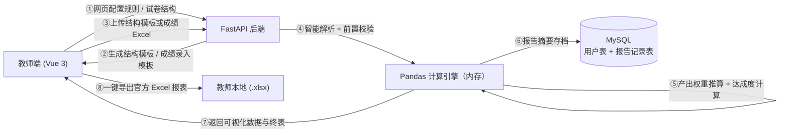

# 课程目标达成度分析系统 — 项目文档

> 📌 本文档在项目开发过程中持续更新完善，记录所有已确认的技术决策与设计细节。

---

## 1. 项目概述

基于 OBE（成果导向教育）理念，建设一个 Web 端的课程目标达成度分析系统。把教师以往依赖复杂 Excel 公式手工计算的达成度分析过程，转化为：**网页配置规则 → 上传成绩表 → 系统自动计算 → 可视化查看 → 一键导出报告** 的完整闭环，显著提升教学质量评价的效率与准确性。

- **项目仓库**: https://github.com/1579231583/course-outcome-attainment-analysis

---

## 2. 技术栈

| 层级 | 技术 | 说明 |
|------|------|------|
| **后端框架** | FastAPI | Python 异步 Web 框架，自动生成交互式 API 文档（Swagger） |
| **ORM** | SQLAlchemy + Alembic | 数据库操作 + 数据库版本迁移管理 |
| **数据库** | MySQL | 存储用户账号与历史报告记录，生产级关系型数据库 |
| **数据计算引擎** | pandas / numpy / openpyxl | 后端内存级矩阵运算、达成度计算与 Excel 文件生成解析 |
| **前端框架** | Vue 3 + Vite | 现代化前端工程化方案 |
| **前端语言** | JavaScript | — |
| **UI 组件库** | 待定（推荐 Element Plus） | — |
| **容器化部署** | Docker + Docker Compose | 编排前端（Nginx）/ 后端（FastAPI）/ 数据库（MySQL）三容器 |
| **AI 扩展（预留）** | 待定（如 Gemini API / OpenAI API） | 后续考虑接入 AI 模型，实现智能分析建议与持续改进辅助 |

---

## 3. 核心架构与数据流向

### 3.1 "轻重解耦"设计原则

> 海量过程分数走内存与文件；轻量账号与报告记录走数据库。

### 3.2 数据库设计原则

MySQL 只存储以下两类轻量数据，不存几千行学生小题分数：

| 数据表 | 存储内容 |
|--------|---------|
| `users` | 教师账号（工号/邮箱、加密密码、姓名等注册信息） |
| `reports` | 历史报告摘要（课程名、学期、班级、各目标达成度%、Excel 文件路径、生成时间） |

原始上传的 Excel 文件以文件形式保存在服务器存储目录，计算由 Pandas 在内存中完成，无需频繁读写数据库。

---

## 4. 核心系统特性

### 4.1 动态 Excel 模板生成
- 教师在网页上配置好考核环节（如：作业、课堂表现；去掉不需要的测验）后，系统**实时动态生成专属模板**，不含多余空列。
- 平时考核环节是可配置集合，不要求固定包含作业、课堂表现和测验；测验、实验、报告等环节可按课程实际情况增删。
- 平时成绩模板只包含已启用的平时环节列；上传时按相同环节配置校验学号、姓名及各环节百分制成绩。
- 列名自带说明（如"作业(40%)"、"第1题(满分3分/目标1)"），便于老师登分时核对。
- 学生名单由教师自行从教务系统复制粘贴，系统不维护学籍库，保持极简。
- 试卷结构支持两种配置方式：
  - 网页端按“大题 → 小题”分组配置，可批量设置小题数量、分值和课程目标，再对个别小题调整；
  - 下载并填写《试卷结构配置模板.xlsx》后上传，模板采用一行一个小题的扁平格式，包含大题号、小题号、题型、小题满分和课程目标。
- 系统根据确认后的试卷结构自动生成《期末小题成绩录入模板.xlsx》，教师只需填写学号、姓名和每道小题得分，不需要手工填写目标归属、目标总分或计算公式。
- 每道小题只对应一个课程目标；系统自动汇总大题总分、试卷总分和各课程目标对应的题目满分。

### 4.2 高容错 Excel 解析
- **动态锚点扫描**：自动向下寻找包含"学号"/"姓名"的行，自动跳过顶部大标题、空行、合并单元格。
- **列名别名容错**：模糊匹配处理（"学号/ID/卡号"、"作业/平时作业"均能识别），自动去除空格与特殊字符。
- **多余列自动忽略**：老师自己加的"备注/班级"列不会导致解析失败。
- **末尾统计行过滤**：自动识别并剔除"平均分/合计"等非学生数据行。
- **模板结构校验**：试卷结构模板检查小题编号重复或遗漏、分值缺失、课程目标无效及试卷总分异常；学生成绩模板检查每道小题得分是否为空、非法或超过该题满分。

### 4.3 列映射确认抽屉
- Excel 上传后，后台解析完先不直接入库，而是弹出**字段映射预览抽屉**。
- 展示"系统字段 ↔ Excel 列名"的对应关系及前 3~5 行数据预览，供教师确认或手动修正。
- 确认无误后点击"确认导入"才正式写入，防止因列顺序颠倒导致数据错位。

### 4.4 在线就地纠错
- 导入预览页若发现小题得分超过该题满分，**自动标红高亮拦截**。
- 教师无需重新修改 Excel 再上传，直接在网页表格中**双击单元格就地修改**，系统立即重新计算。

### 4.5 计算结果多维呈现

| 呈现层次 | 内容描述 |
|---------|---------|
| **达成度指标卡片** | 顶部大字显示各目标达成度百分比；绿色=达标，黄色=未达标（含阈值对比提醒） |
| **评价终表所见即所得** | 完整展示《课程目标评价达成情况表》（满分行 + 实得均分行 + 达成度%） |
| **柱状对比图** | 各课程目标达成度对比柱状图，配合合格基准红虚线，可直接复制图片用于教学汇报 |
| **双重 Excel 一键导出** | ①《评价汇总表.xlsx》（教务存档/认证用）；②《全班得分明细表.xlsx》（逐人逐题，供备查） |

### 4.6 单班级核算
- 每次分析以一个具体教学班为独立核算单元（如："高等数学A(II) 2023-2024-2 · 23智能制造1班"）。
- 不引入多班级合并计算，保持逻辑清晰简洁。

### 4.7 AI 智能分析（预留扩展）
- 后续版本考虑接入 AI 大模型（如 Gemini API），基于达成度结果自动生成：
  - 教学问题诊断（哪个目标、哪个环节拉低了达成度）；
  - 个性化持续改进建议；
  - 一键生成符合 OBE 格式规范的"教学改进说明"文本草稿。
- 当前架构预留 AI 接口扩展点，不影响核心功能开发。

---

## 5. 待确认事项

| 编号 | 待确认内容 | 负责行动 |
|------|-----------|---------|
| ① | 期末试卷题目结构的最优录入方式（网页点选 / 上传双向细目表 / 两者并存） | 待与一线教师调研后确认 |
| ② | 达成度合格阈值默认值（通常 0.65），是否允许教师课程级自定义 | 待确认 |
| ③ | 是否在报告中加入"未达标原因分析"与"持续改进措施"文本填写区（OBE 认证刚需） | 待确认 |
| ④ | UI 组件库最终选型（Element Plus / Ant Design Vue / Naive UI） | 待前端搭建时确认 |

---

## 更新日志

| 日期 | 内容 |
|------|------|
| 2026-11-17 | 初始化文档，确定 FastAPI + Vue 3 技术栈，建立 Git 仓库 |
| 2026-11-17 | 完成数据流程设计，确定 pandas 内存计算方案 |
| 2026-11-17 | 确定"轻重解耦"架构，MySQL 仅存用户账号与历史报告摘要 |
| 2026-11-17 | 确定动态模板生成、单班级核算、列映射抽屉与就地纠错机制 |
| 2026-11-17 | 确认数据库升级为 MySQL（生产级），预留 AI 扩展接口 |
| 2026-11-17 | 确定试卷采用“大题分组 + 小题明细”，支持结构模板导入并自动生成小题成绩模板 |
| 2026-11-18 | 完成全流程体验 Demo：成绩评定方法、目标与环节矩阵、学生成绩校验与达成度展示 |
| 2026-11-18 | 确认平时考核环节可动态增删；测验不是固定必需环节，无测验时可只保留作业、课堂表现等启用环节 |
| 2026-11-18 | 补全全流程体验中的期末试卷结构配置：可设置大题名称、小题满分和课程目标，并校验试卷总分为100分 |
| 2026-11-18 | 全流程体验支持直接上传真实 `.xlsx` 平时成绩表和期末小题成绩表；已用44人两份Excel完成端到端计算 |
| 2026-11-18 | 完成第一阶段 Demo：成绩评定方法可配置平时/期末占比、动态增删平时环节并实时校验比例 |
| 2026-11-18 | 第二阶段完成课程目标与考核环节对应关系配置：动态课程目标、支撑系数矩阵及理论满分预览 |
