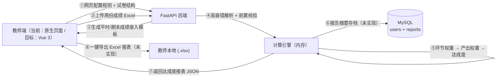

# 课程目标达成度分析系统 — 项目文档

> 📌 本文档在项目开发过程中持续更新完善，记录所有已确认的技术决策与设计细节。
>
> **当前状态（2026-11-18）**：已完成「计算内核 + 可运行 Web Demo」，五步算法经 44 人真实数据端到端验证。数据库、用户体系、导出、可视化图表尚未开始。

---

## 1. 项目概述

基于 OBE（成果导向教育）理念，建设一个 Web 端的课程目标达成度分析系统。把教师以往依赖复杂 Excel 公式手工计算的达成度分析过程，转化为：**网页配置规则 → 下载模板 → 上传成绩表 → 系统自动计算 → 可视化查看 → 一键导出报告** 的完整闭环。

- **项目仓库**: https://github.com/1579231583/course-outcome-attainment-analysis

---

## 2. 技术栈

### 2.1 目标技术栈（最终形态）

| 层级 | 技术 | 说明 |
|------|------|------|
| **后端框架** | FastAPI | Python 异步 Web 框架，自动生成 Swagger 文档 |
| **ORM** | SQLAlchemy + Alembic | 数据库操作 + 版本迁移 |
| **数据库** | MySQL | 存储用户账号与历史报告记录 |
| **计算引擎** | openpyxl（当前）/ pandas + numpy（后续） | Excel 解析与矩阵运算 |
| **前端框架** | Vue 3 + Vite | 现代化前端工程化方案 |
| **UI 组件库** | 待定（推荐 Element Plus） | — |
| **容器化部署** | Docker + Docker Compose | 前端 Nginx / 后端 FastAPI / MySQL 三容器 |
| **AI 扩展（预留）** | 待定 | 智能分析建议与持续改进辅助 |

### 2.2 当前 Demo 实际技术栈

| 层级 | 实际使用 | 说明 |
|------|---------|------|
| 后端 | FastAPI + uvicorn + python-multipart | 3 个依赖，已装在 `backend/venv`（Python 3.12.4） |
| Excel | openpyxl | 唯一的数据处理库，未引入 pandas |
| 前端 | 原生 HTML + CSS + JavaScript | 无构建步骤，`frontend/` 直接由 FastAPI 静态托管 |
| 配置存储 | Python 模块内存变量 | 重启即恢复默认，**未接数据库** |

> 依赖按需逐步引入，不提前铺开。

---

## 3. 核心架构与数据流向

### 3.1 "轻重解耦"设计原则

> 海量过程分数走内存与文件；轻量账号与报告记录走数据库。



### 3.2 数据库设计原则（已实现 `backend/db.py`，后续可无缝切 SQLAlchemy + MySQL）

采用轻重解耦的 3 表结构（本地默认使用内置 SQLite `attainment.db` 开箱即用，表结构兼容 MySQL）：

| 数据表 | 存储内容 |
|--------|---------|
| `users` | 用户账号（工号/账号、加盐哈希密码、姓名、院系、角色 `teacher`/`admin`、启用状态、创建时间） |
| `courses` | 课程与规则模板库（所属用户、是否管理员发布的公共模板 `is_public`、课程名称、代码、学期、默认班级、合格阈值 `pass_threshold`、规则配置 JSON `method/matrix/paper/target_descriptions`）。支持管理员通过 Excel 导入公共模板供全院教师一键选用，也支持教师自建私有模板跨班复用 |
| `class_reports` | 班级达成度历史报告（关联课程 ID、班级名称、人数、达成度汇总 JSON、确认后的学生成绩快照 JSON、持续改进记录，支持随时复看大屏、重新导出三 Sheet Excel 及重载修改） |

---

## 4. 当前代码结构

```
课程目标达成度分析系统/
├── backend/
│   ├── calc_engine.py      ★ 计算内核（配置驱动 + 五步算法 + 边界保护 + 非阻断预览解析）
│   ├── db.py               ★ 数据库持久化层（users / courses / class_reports 三表 + 双角色 + 公共模板库）
│   ├── course_template.py  ★ 公共课程规则模板 Excel（3 Sheet）生成与导入解析
│   ├── diagnostics.py      ★ OBE 诊断 Agent 4 维下钻分析工具与改进草稿生成
│   ├── export_report.py    ★ 三 Sheet 归档报表导出（达成度计算表 + 评价汇总表 + 全班得分明细表）
│   ├── api.py              ★ FastAPI 服务（共 30 个接口：认证/配置/模板/解析/计算/导出/诊断/管理员）
│   ├── test_api.py         ★ 后端 8 项全流程一键验收测试脚本
│   ├── gen_template.py       按试卷结构生成期末录入模板（脚本版）
│   ├── fill_templates.py     生成示例填充数据（脚本版）
│   ├── gen_sample_exam.py    生成合理的示例试卷得分（正态分布、难度递增）
│   ├── calc_demo.py          旧版：解析试卷分解表（已被 calc_engine 取代，保留参考）
│   └── venv/                 虚拟环境
├── frontend-vue/           ★ Vue 3 + Vite + Element Plus + ECharts 工程化前端
│   ├── src/
│   │   ├── api/client.js       统一 API 请求与 Excel 流下载封装
│   │   ├── components/
│   │   │   ├── LoginView.vue   双角色登录与教师注册页
│   │   │   ├── ConfigStep.vue  步骤1：课程信息、评定方法、目标矩阵、产出权重预览、试卷批量加题、公共模板选用
│   │   │   ├── ScoreStep.vue   步骤2：成绩上传、一键示例数据、列映射抽屉、类 Excel 可视化增删查改与标红纠错
│   │   │   ├── ReportStep.vue  步骤3：KPI 卡片、ECharts 双图、评价终表、OBE 诊断下钻与持续改进、三 Sheet 导出
│   │   │   ├── HistoryView.vue 历史班级报告归档（查看大屏 / 重新导出 Excel / 重载修改）
│   │   │   └── AdminView.vue   教务管理后台（公共模板 Excel 导入发布 / 教师账号管理 / 全院监控预警）
│   │   ├── App.vue             左侧极简导航 + 顶部课程切换与三步工作流主框架
│   │   └── styles.css          学术数据工作台统一样式与等宽数字排版
│   └── dist/                   Vite 构建产物（由 FastAPI 自动优先静态托管）
├── frontend/               旧版原生 HTML+JS Demo（保留备份）
├── 示例/                    44 人真实示例数据（平时成绩表、期末模板、矩阵表等）
├── 测试数据集/01/           模板文件副本
└── docs/                   需求分析 / 项目文档 / 达成度计算流程 / 开发流程
```

### 4.1 计算内核关键函数

| 函数 | 职责 |
|------|------|
| `clean(v)` / `to_num(v)` | 单元格清洗（去 `\xa0`）、安全转数值 |
| `normalize(name)` | 列名归一化：去空格、去括号内容（`作业（20%）` → `作业`） |
| `find_header(rows, required)` | 动态锚点扫描，定位表头行 |
| `match_column(names, keyword, aliases)` | 三级匹配：精确 → 别名 → 模糊包含 |
| `build_column_mapping(names, fields, aliases_map)` | 返回 `(mapping, missing)`，对应“列映射确认” |
| `validate_structure()` | 校验总分 100、题号连续、目标有效，返回扁平题目列表 |
| `paper_target_full(questions)` | 各目标卷面满分（示例：目标1=81、目标2=19） |
| `step1_link_weights()` | 环节权重 |
| `step2_output_weights(link_weights)` | 列归一化产出权重 + 理论满分 |
| `load_daily_students(verbose)` | 平时表解析，返回学生列表 |
| `load_final_scores(students, questions)` | 期末表解析，**返回匹配人数 int** |
| `step5_report(students, output, full, questions)` | 汇总达成度报表 |

### 4.2 API 接口

| 方法 | 路径 | 说明 |
|------|------|------|
| GET | `/api/config` | 读取当前配置（method / matrix / paper） |
| POST | `/api/config` | 保存配置（内存态），校验占比之和、试卷总分 |
| GET | `/api/template/daily` | 下载《平时成绩录入模板.xlsx》 |
| GET | `/api/template/final` | 下载《期末小题成绩录入模板.xlsx》 |
| POST | `/api/calculate` | 上传两份 Excel，返回完整报表 JSON |
| GET | `/` | 静态托管 `frontend/` |

### 4.3 启动方式

```powershell
cd backend
.\venv\Scripts\Activate.ps1
python -m uvicorn api:app --reload --port 8000
# 浏览器打开 http://127.0.0.1:8000
```

命令行直接跑算法（不启服务）：`python calc_engine.py`

---

## 5. 核心系统特性

### 5.1 动态 Excel 模板生成 ✅ 已实现
- 平时模板列 = `学号 | 姓名 | 已启用的平时环节…`，环节可增删。
- 期末模板列 = `学号 | 姓名 | 第N题(满分/课程目标)…`，由试卷结构自动生成。
- 学生名单由教师自行从教务系统复制，系统不维护学籍库。
- 下载文件名为中文（`平时成绩录入模板.xlsx` / `期末小题成绩录入模板.xlsx`）。

### 5.2 高容错 Excel 解析 ✅ 已实现
- **动态锚点扫描**：跳过顶部合并标题行（示例表首行是“教师评定与记录”）、空行。
- **列名别名容错**：`平时作业/作业成绩/课后作业`、`课堂参与/考勤/表现`、`小测验/随堂测验/测试` 均可识别。
- **多余列自动忽略**：教师自加的“平时成绩”“备注”列不影响解析。
- **末尾统计行过滤**：`平均/合计/最高/最低/及格率/标准差/汇总` 等行自动剔除。
- **学号清洗**：自动去除 `\xa0`（不换行空格），示例数据学号带此字符。

### 5.3 前置数据校验 ✅ 已实现
- 平时：非空、0~100、学号不重复。
- 期末：非空、非负、≤ 该题满分、学号不重复、每人必须有期末成绩。
- 配置：平时环节占比和 = 1、平时+期末 = 1、试卷总分 = 100、题号从 1 连续、目标必须在矩阵中。

### 5.4 列映射确认抽屉 ⏳ 未实现
- 后端已具备 `build_column_mapping` 返回映射与缺失字段的能力。
- 前端尚未做“上传后弹窗预览映射 + 前 3~5 行数据 + 手动修正下拉”。

### 5.5 在线就地纠错 ⏳ 未实现
- 计划：超分单元格标红拦截，双击就地修改并实时重算。

### 5.6 计算结果多维呈现 🟡 部分实现
- ✅ 已实现：达成度表格（平时贡献 / 期末贡献 / 实得 / 理论满分 / 达成度徽章，≥0.65 绿色）、环节权重表。
- ✅ 已实现：**配置区产出权重实时预览**——矩阵下方展示「环节权重行 + 各目标产出权重 + 理论满分」，并显示各列比例之和；全 0 列标红提示无法分配。前端 `calcOutputWeights()` 与后端 `step2_output_weights()` 算法一致，已交叉验证。
- ✅ 已实现：**导出《达成度计算表》Excel**——按学校现有表格格式复刻（见 5.7）。
- ⏳ 未实现：指标卡片、柱状对比图、评价终表（按环节展开的满分行/实得行）。

### 5.7 达成度计算表导出 ✅ 已实现

模块：`backend/export_report.py`，接口：`POST /api/export`（上传两个成绩表，直接返回 xlsx）。

**表格结构**（与学校现有《达成度计算表》逐格对齐，A1:K51、16 个合并区）：

| 行 | 内容 |
|---|---|
| 1 | 标题「达成度计算表」（合并 A1:K1） |
| 2 | 课程名称 / 学期 / 班级（三段合并） |
| 3 | 序号 \| 学号 \| 姓名 \| 课程目标1（64分）[合并] \| 课程目标2（36分）[合并] |
| 4 | 各环节理论满分，如「作业5.33333」「期末考试50」 |
| 5~N | 学生逐人逐环节得分 |
| N+1 | 各子项得分（`=AVERAGE(...)` 公式） |
| N+2 | 各目标实际得分（`=D49+E49+F49+G49` 公式） |
| N+3 | 达成度（`=D50/64.4000` 公式） |

**设计要点**：
- 汇总行用 **Excel 公式**而非硬编码数值，教师打开后可自行核对、改动明细后自动重算。
- 个人得分计算：平时环节 = 原始百分制分 × 产出权重；期末 = (该目标卷面实得 ÷ 该目标卷面满分) × 该目标期末设定分值。
- 课程元信息（课程名称/学期/班级）存于 `api.META`，随 `/api/config` 一起读写。

**已验证**：示例 44 人数据导出后，各目标实际得分 40.5108 / 27.3984，达成度 62.90% / 76.96%，与 `step5_report` 逐位一致。

### 5.8 单班级核算 ✅ 设计确定
- 每次分析以一个教学班为独立核算单元，不做跨班合并。

### 5.9 AI 智能分析（OBE 诊断 Agent + 预留 RAG 扩展）🔮 规划确定
- **核心方向（OBE 诊断 Agent）**：不满足于简单的“单次提示词调 API”，而是设计为基于 **Tool-Calling** 的智能诊断 Agent，调用后端真实数据统计工具进行多步下钻分析：
  1. `环节得分率下钻工具`：定位拉低达成度的具体考核环节；
  2. `期末难题诊断工具`：定位全班得分率最低的 Top N 小题；
  3. `学情分布画像工具`：分析全班个人达成度分布与“平时高、期末低”反差学生；
  4. `历史/平行班对比工具`：检索 `class_reports` 同课程往期或平行班数据横向对比。
- 综合上述真实数据生成有理有据的《达成情况诊断与持续改进措施》，并支持随报告存档及导出。
- **RAG 知识库扩展（远期预留）**：预留教学大纲与往年持续改进报告的检索增强（RAG）扩展点，后续按需讨论展开。

---

## 6. 已验证结论（回归基准）

| 项目 | 结果 |
|------|------|
| 学生数 | 44 人，期末匹配 44 人 |
| 环节权重 | 作业 16% / 课堂表现 16% / 测验 8% / 期末 60% |
| 产出权重（目标1） | 5.33 / 6.40 / 2.67 / 50.00 |
| 产出权重（目标2） | 10.67 / 9.60 / 5.33 / 10.00 |
| 理论满分 | 目标1 = 64.40，目标2 = 35.60 |
| 达成度 | 目标1 = **62.9%**（未达标），目标2 = **77.0%**（达标） |
| 单学生验算 | 俞高敏 目标1 71.5% / 目标2 82.6%，与引擎逐位一致 |
| 脏数据测试 | 合并标题行 + 别名列名 + 统计行，44 人全部正确解析 |
| 导出表校验 | 三 Sheet 工作簿生成成功（51×11 达成度计算表 + 8×9 评价汇总表 + 45×29 学生得分明细表），与引擎逐位一致 |

---

## 7. 已拍板确认事项（原待确认清单收口）

| 编号 | 事项 | 最终确认结论 |
|------|------|------|
| ① | 期末试卷结构与公共模板录入方式 | ✅ 已定：网页支持大题/小题配置与**批量添加小题**；同时**管理员端支持上传标准《课程规则配置模板.xlsx》一键导入公共模板**供全院教师取用 |
| ② | 达成度合格阈值 | ✅ 已定：默认 `0.65`，支持课程级自定义配置 |
| ③ | “未达标原因分析 + 持续改进措施” | ✅ 已定：报告页提供编辑区，支持规则草稿 + 后续接入 **OBE 诊断 Agent** 自动生成，随报告保存并导出 |
| ④ | 前端技术栈与设计方向 | ✅ 已定：Vue 3 + Vite + Element Plus + ECharts，打造学术数据工作台风格 |
| ⑤ | 矩阵列归一化预览 | ✅ 已实现：矩阵区实时预览产出权重、理论满分及列和提示 |
| ⑥ | 角色与数据库方案 | ✅ 已定：教师端（开箱即用 + 选用公共模板/自建私有配置）+ 轻量管理员端（账号管理 + 公共模板库 + 全院监控）；数据库采用 3 表轻重解耦，兼容 SQLite/MySQL |

---

## 更新日志

| 日期 | 内容 |
|------|------|
| 2026-11-17 | 初始化文档，确定 FastAPI + Vue 3 技术栈，建立 Git 仓库 |
| 2026-11-17 | 完成数据流程设计，确定 pandas 内存计算方案 |
| 2026-11-17 | 确定"轻重解耦"架构，MySQL 仅存用户账号与历史报告摘要 |
| 2026-11-17 | 确定动态模板生成、单班级核算、列映射抽屉与就地纠错机制 |
| 2026-11-17 | 确认数据库升级为 MySQL（生产级），预留 AI 扩展接口 |
| 2026-11-17 | 确定试卷采用“大题分组 + 小题明细”，支持结构模板导入并自动生成小题成绩模板 |
| 2026-11-18 | 完成全流程体验 Demo：成绩评定方法、目标与环节矩阵、学生成绩校验与达成度展示 |
| 2026-11-18 | 确认平时考核环节可动态增删；测验不是固定必需环节 |
| 2026-11-18 | 补全期末试卷结构配置：大题名称、小题满分、课程目标，校验总分 100 |
| 2026-11-18 | 支持直接上传真实 `.xlsx` 平时成绩表和期末小题成绩表；44 人端到端计算通过 |
| 2026-11-18 | 完成第一阶段 Demo：平时/期末占比可配置、平时环节动态增删并实时校验比例 |
| 2026-11-18 | 第二阶段完成课程目标与考核环节对应关系配置：动态目标、支撑系数矩阵及理论满分预览 |
| 2026-11-18 | **确定“结构配置与成绩录入分离”方案**：试卷结构在系统配置，系统生成录入模板，教师只填分 |
| 2026-11-18 | 重写示例试卷数据（正态分布、难度递增、无空白、不超分），修正原数据不合理问题 |
| 2026-11-18 | 计算内核改为配置驱动，新增高容错解析（锚点扫描/别名/统计行过滤）并通过脏数据测试 |
| 2026-11-18 | 模板下载文件名改为中文；完成单学生全流程手工推演校验 |
| 2026-11-18 | 同步四份文档，修正《达成度计算流程》中与引擎不一致的数值（64.40/35.60、62.9%/77.0%） |
| 2026-11-18 | 界面改进 A 阶段：矩阵区新增产出权重实时预览（环节权重行 + 产出权重 + 理论满分 + 列和提示），前端算法与后端交叉验证一致 |
| 2026-11-19 | 后端架构与算法全面升级：新增 `db.py` 三表持久化（`users`/`courses`/`class_reports`）；`calc_engine.py` 补全整列全0拦截、不考期末目标除零保护、非阻断预览解析 `parse_sheets_for_preview`；`export_report.py` 升级为三 Sheet 工作簿（达成度计算表 + 评价汇总表 + 全班得分明细表）；`api.py` 支持预填学生名单的模板下载与基于在线纠错 JSON 的计算/导出 |
| 2026-11-19 | 完成全部待确认需求收口：确定双角色（教师端 + 轻量管理员端）、管理员 Excel 导入公共课程模板库供教师一键选用、在线成绩可视化增删查改、OBE 诊断 Agent 规划（RAG 远期保留） |
